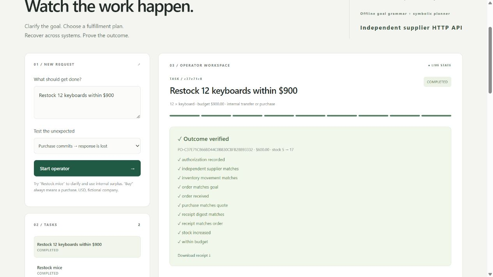
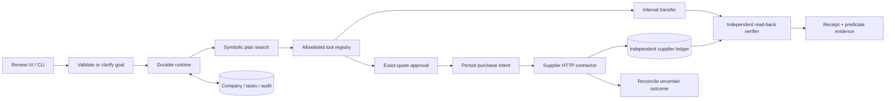

# Relay 2 — a standalone company operator

**An outcome owner with alternative plans, human authority, cross-system recovery and evidence.**

[Watch the demo video](https://github.com/shreekruthi/centralign-relay/blob/main/docs/demo.mp4) · [Source repository](https://github.com/shreekruthi/centralign-relay) · [Validation report](docs/TEST_REPORT.md)

Built for the CentrAlign AI Founding Engineer take-home. Relay handles one useful company workflow: get additional equipment into ready-to-use inventory, within a stated budget and company rules. It can clarify a missing goal, fulfill from internal surplus, or purchase through a separate supplier HTTP API. It verifies the selected outcome before declaring completion.

The most important demo is an uncertain write: the supplier commits a purchase to **its own database**, then closes the socket without a response. Relay records the uncertainty, queries the independent supplier ledger and adopts the existing order. It does not send another checkout request.



## Start in two minutes

You need **Python 3.11+** and a browser. No pip installation, Docker, Node, model download, API key or real company account is required.

1. Extract the project and open a terminal in the folder containing this README.
2. Run:

```sh
python run.py
```

3. Open **http://127.0.0.1:8765**. Keep the terminal running.

On Windows you can also double-click **start.bat**. If `python` is unavailable, try `py run.py` on Windows or `python3 run.py` on macOS/Linux. Install Python from [python.org](https://www.python.org/downloads/) if needed.

One command starts the review UI, background operator and supplier HTTP service. The supplier chooses a free loopback port automatically. Both databases persist beside each other:

- `data/relay.sqlite3`: company records, task state, approval decisions, audit history and purchase intents.
- `data/relay.supplier.sqlite3`: independently committed supplier stock and purchases.

The supplier request token is generated locally at startup; no real credential is used or stored. Stop with `Ctrl+C`; restart the same command to resume persisted work. An abruptly killed active task can wait up to 30 seconds for its lease to expire.

For an unused UI port or a fresh demo without deleting anything:

```sh
python run.py --db data/fresh.sqlite3 serve --port 8770
```

Always preserve **both** database files when backing up or moving an active demo. Never pair a company database with a new empty supplier ledger if it contains outstanding purchases.

## Three demonstrations worth showing

| Request / scenario | Operator's decision | Evidence |
|---|---|---|
| `Restock mice` / Normal | Ask for missing quantity and budget. Answer 3 units and $1. Discover 6 surplus mice and choose an internal transfer. | Ready stock 5→8, surplus 6→3, $0 spend, no external order, verified transfer receipt. |
| `Restock 12 keyboards within $900` / Purchase commits → response is lost | Obtain exact $600 approval; persist purchase intent; call supplier; observe lost response; reconcile through its ledger. | One checkout call, one supplier order, stock 5→17, 10 read-back checks pass. |
| `Restock 12 keyboards within $900` / Supplier fails | Invalidate Atlas's $600 authorization, exclude it for this task, choose Beacon, request fresh $720 approval. | Only the approved replacement is purchased and verified. |

All counts assume a fresh database. **Restock means add units**, not reach a target total. An explicit **Buy/Purchase** request always uses the purchase path, even when surplus exists. Partial transfers plus purchases are not supported. Fault scenarios apply only when the selected path uses the relevant tool; an internal transfer never calls checkout.

Additional scenarios cover two transient failures with backoff, an executor interruption after purchase commit, and an incorrect receipt that must leave the task in `needs_attention`.

## What demonstrates autonomy

The operator does not run a saved list of steps to completion. It gathers inventory and policy, searches over available action predicates, executes one tool, observes the result and plans again. A discovered surplus enables a shorter transfer plan. A changed surplus can invalidate that plan and require purchasing instead. A missing quantity/budget creates a durable clarification checkpoint. An uncertain purchase disables another checkout action and enables reconciliation.

This is an **authored symbolic domain**, not unrestricted LLM reasoning. It generalizes across supported products, amounts, budgets, stock conditions and supplier failures. A new business workflow needs another intent contract, domain actions and tools. The optional local model interprets complete goals only; it does not choose tools or create novel workflows.

## Test it

```sh
python -m unittest discover -s tests -v
```

The suite includes the local reference connector plus real HTTP integration tests against the separate supplier ledger. It covers actual response loss after commit, recovery in a new process, no duplicate checkout, unresolved uncertainty, changed quotes, approvals, alternate plans, surplus races, clarification, retrieved company history and read-back failures. See the exact [validation report](docs/TEST_REPORT.md), [test output](docs/test-output.txt) and [result JSON](docs/test-results.json).

CI is configured for Python 3.11/3.14 on Windows, Ubuntu and macOS. The report distinguishes locally executed checks from configured but unexecuted remote CI.

## Demo and reviewer materials

- [Captioned demo video](docs/demo.mp4): assembled from actual version 2 browser screenshots; editorial pauses are disclosed.
- [Five-minute continuous-demo recording script](docs/DEMO.md): exact actions and narration for recording your own uninterrupted walkthrough.
- [Architecture and invariants](docs/ARCHITECTURE.md).
- [Technical decisions, assumptions and components](docs/DECISIONS.md).
- [Technical discussion and debugging guide](docs/INTERVIEW.md).
- [Actual HTTP recovery trace](docs/sample-evidence.json), [transfer trace](docs/transfer-evidence.json), [supplier reconciliation proof](docs/supplier-proof.json).

The included video is a captioned visual walkthrough, not a continuous screen recording or a latency benchmark. Run the app for an interactive demonstration; record your own continuous presentation with the script before applying if possible.

## CLI

```sh
python -m operator_app --db data/cli.sqlite3 demo --scenario timeout_after_commit --approve --export data/evidence.json
python -m operator_app --db data/transfer.sqlite3 demo --goal 'Restock 3 mice within $1' --scenario normal
python -m operator_app show TASK_ID
python -m operator_app clarify TASK_ID --quantity 3 --budget 150
python -m operator_app decide TASK_ID APPROVAL_ID approve
python -m operator_app resume TASK_ID
```

Replace identifiers with the printed values. Supply only missing fields to `clarify`. Use the same `--db` filename across commands. The explicit CLI `--approve` flag authorizes fictional demo decisions for unattended runs; the UI always requires separate human decisions. `resume` never bypasses a checkpoint or reopens a terminal task.

## Company context and memory

Tools read versioned policy, current inventory, surplus and live supplier catalog data. Task facts, failed suppliers, retries, pending purchase intents and approvals survive restarts. Completed verified outcomes are retrieved with provenance on subsequent tasks: historical supplier success breaks **equal-price ties only**. History never authorizes spending, overrides current stock, excludes a supplier permanently, or trains a model. Policy updates require explicit company data changes.

## Architecture



The application starts two local HTTP servers in one process for easy setup. They own separate databases and communicate over real HTTP. This is a genuine transaction and transport boundary, not a claim of separately deployed production microservices. `Runtime(store)` uses a local reference backend for fast unit tests; the launcher and CLI use `Runtime(store, supplier_client)`.

## Models, services and pre-built components

| Component | Implementation |
|---|---|
| Goal understanding | Bounded grammar; structured clarification for omitted fields |
| Planning | Custom uniform-cost search over declared predicates |
| Execution | 13 allowlisted local/HTTP tools |
| Persistence | Standard-library SQLite with WAL and explicit transactions |
| UI/server | HTML, CSS, JavaScript, Python `http.server`; no external assets |
| Supplier integration | Stateful fictional HTTP supplier with independent SQLite ledger and idempotency contract |
| Tests | Python `unittest`, subprocess recovery, actual local HTTP |
| Optional model | User-installed Ollama model through local `/api/chat`, schema-validated goal interpretation only |
| Development assistance | OpenAI Codex; understand and review the code before submitting |

Optional complete-goal interpretation:

```sh
python -m operator_app serve --ollama-model YOUR_INSTALLED_MODEL
```

Use an already installed model name from `ollama list`. Model mode has contract tests with fake transport; **live model inference was not tested**. The default offline mode and real supplier HTTP path were tested. A local model can misinterpret a valid request; inspect the understood intent in the trace. Model mode does not implement partial-goal clarification and does not silently fall back on an invalid response.

## Assumptions and known limits

- One fictional company, one trusted local reviewer, three SKUs, USD integer cents, quantities 1–100. No tax, shipping, cancellation, refunds or partial fulfillment.
- Internal surplus has one source and one destination. Immediate supplier fulfillment is simulated, but its order, stock and transport effects are real within the sandbox.
- The grammar supports buy/restock/purchase, quantity, product, and budget. It rejects other instructions. Clarification handles omitted quantity/budget, not arbitrary conversation.
- No browser or desktop automation connector is implemented. The running workflow uses actual HTTP, database and receipt tools; the scope remains deliberately narrow.
- Cross-system safety means idempotent supplier requests plus durable intent and reconciliation. **It is not a universal exactly-once guarantee.** If a pending outcome cannot be established, the task stops for investigation instead of blindly purchasing again.
- The supplier's lookup contract is authoritative after a commit. A real vendor needs documented idempotency, consistency and reconciliation semantics. The prototype does not retry an unresolved pending POST merely because a lookup returns absent.
- Local loopback/Host/Origin/token checks are not production identity, tenancy or secret management. Keep both services local. The transient token is a sandbox capability, not a real company credential.
- No distributed queue, lease heartbeat/fencing for long external calls, scheduler, production migrations or tamper-proof audit storage. Outbound operations have short timeouts; a production design needs stronger coordination.
- Verification proves consistency across the sandbox records at a point in time. Receipt SHA-256 is an integrity check, not a digital signature or proof of physical delivery.
- `needs_attention` preserves partial success. It does not automatically repair evidence, cancel purchases or retry a terminal task.
- Version 2 adds tables and one column non-destructively to a version 1 company file. Use a fresh database for the new HTTP demo; an old local-backend order has no independent supplier record.

## Next steps

1. Introduce an authenticated vendor sandbox connector with contract tests against its real idempotency/reconciliation guarantees.
2. Add reviewer identities, approval revocation, scoped tenant permissions and append-only external audit storage.
3. Add lease renewal/fencing, queue-backed workers, circuit breakers, deadlines and designed compensating actions.
4. Evaluate a constrained model planner against the deterministic baseline and adversarial goal/tool traces before granting it broader action selection.
5. Add one different workflow to test abstraction quality, rather than expanding unsupported surface area.

## Publish to GitHub

Create an empty repository, then run from this project folder:

```sh
git init
git add .
git commit -m "Build Relay standalone company operator"
git branch -M main
git remote add origin https://github.com/shreekruthi/centralign-relay.git
git push -u origin main
```

Runtime databases, test scratch files and secrets are excluded by `.gitignore`. Review the source and recorded demo before using them in an application.

License: [MIT](LICENSE).
