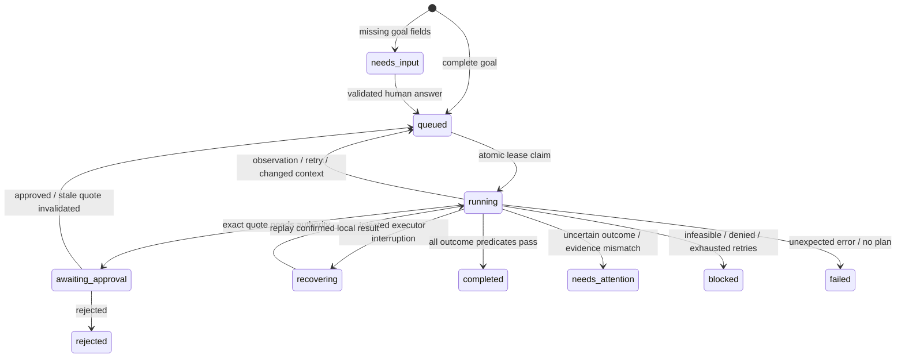

# Runtime architecture and guarantees

## An explicit outcome

The canonical intent is `{sku, quantity, budget_cents}`. “Restock” permits internal redistribution or purchasing; “Buy/Purchase” requires purchasing. Quantity means additional ready inventory. Missing quantity/budget produces `needs_input`; clarification fills exactly those missing fields on the same persisted task. No company tool executes before the contract is complete.

## Planning with information gathering and alternatives

The generic planner uses uniform-cost search over `Action(requires, adds, cost)`. The runtime initially targets observed inventory, then observed policy. Once these uncertain inputs are known, it searches for `verified`.

Available fulfillment paths:

1. **Internal:** `transfer_surplus → write_transfer_receipt → verify_transfer`. Enabled when restocking permits transfer and observed surplus can satisfy all units.
2. **Purchase:** `search_suppliers → choose_quote → authorize → place_order → receive_order → write_receipt → verify_outcome`.
3. **Uncertain purchase:** checkout is removed from the action set and `reconcile_purchase` is enabled. An unresolved pending purchase cannot become a new purchase or transfer.

The internal path has fewer actions and zero spend. The purchase tool separately ranks approved, stocked, budget-feasible suppliers by price, using verified prior success only for ties. Every step executes one tool and replans from its observation. A changed surplus invalidates context and can turn an internal plan into a purchase plan.

The domain vocabulary and enablement rules are authored, not model-discovered. The generic search does not imply arbitrary workflow generalization. A different workflow still needs its own intent, predicates, tools and verifier.

## State machine

The worker scans persisted active tasks. Claims use a random token, a 30-second lease, serialized SQLite write transactions and an 80-decision task bound. Due timestamps persist backoff instead of blocking the worker. Normal transient operations have three attempts. Unknown purchase outcomes are reconciled with bounded attempts and then require investigation.

## Two databases, one deliberate transaction boundary

The launcher starts a company HTTP UI and a supplier HTTP API in one process, each on loopback. The supplier owns an independent SQLite ledger and does not access company state. A short-lived random capability token restricts its API to the local connector. Restart regenerates that token but preserves supplier idempotency records.

Company tables include tasks, observations/events, approvals, policy, ready stock, surplus, transfers, receipts, purchase intents, orders, stock movements, tool calls and verified memories. Supplier tables include catalog stock/version and committed purchases keyed by a stable task UUID.

Unit tests also use a local reference connector, which retains the original single-database transaction behavior. The actual launcher, CLI demos and HTTP integration tests use the supplier API.

## Purchase protocol

1. Validate canonical intent, live company policy, supplier approval, live catalog/version, quote expiration and exact human authority.
2. Commit `purchase_intents(task_id, fingerprint, quote, pending)` in the company database.
3. Release that transaction, then POST to the supplier with the stable task UUID as idempotency key.
4. The supplier serializes its own transaction, checks quote/stock, commits its order and stock decrement, and returns a confirmed record.
5. Compare that record with the durable exact intent, then commit a local order and successful tool result.
6. Persist the runtime observation separately and continue.

The supplier returns an existing order for the same key and exact contract, and rejects using that key for a different contract. Its idempotency lookup happens before quote-expiry checks, so an existing committed order remains reconcilable after its original quote expires.

The response-loss demo **actually closes the socket after step 4**. The runtime observes transport uncertainty, not an injected success object. It replans to GET the supplier record. If a process exits before observing the failure, the next execution sees the already-persisted pending intent and also performs lookup before checkout. No second POST is necessary.

An absent or unavailable lookup does not prove that a pending write never happened. The runtime does not blindly resubmit. After bounded unsuccessful reconciliation it preserves the task as `needs_attention`. This conservative behavior can require manual work when a request never reached the supplier; that is safer than assuming absence is authoritative.

This is not global exactly-once execution. A real connector must define retention of idempotency keys, lookup consistency, timeout behavior and reconciliation semantics. Long operations also require renewed leases and fenced writes; the current short-timeout local service is a prototype boundary.

## Internal transfer protocol

The operator checks the observed surplus version and available quantity again at write time. The transfer identity is unique per task. Ready stock increment, surplus decrement, version update and transfer record commit together. A replay cannot move stock twice. A detected source race invalidates inventory and plans again; insufficient remaining surplus enables purchasing.

The transfer verifier independently reads the transfer, both stock locations and its receipt. It checks exact SKU/quantity, ready stock increase, source decrease, receipt identity/digest, zero spend, and absence of a local purchase for the task. Transfers are prohibited if a purchase intent is pending/confirmed or a purchase already exists.

## Approval and changing authority

Quotes bind vendor, SKU, quantity, total/unit price, supplier version, company policy version, expiry and selection explanation in a SHA-256 fingerprint. Above the policy threshold, a matching task-scoped human decision is mandatory at the purchase write boundary. A new supplier or changed quote invalidates prior authorization.

Approval is a local trusted-human checkpoint, not an authenticated signature. An external purchase already committed under its earlier authority must be reconciled and recorded even if policy later changes; changing local policy cannot undo a remote side effect.

## Verification and evidence

Purchase verification queries the company order, movement, ready stock and receipt, then separately queries the supplier ledger. Ten predicates establish goal correspondence, budget, quote identity, authorization, fulfillment, stock movement, stock increase, receipt correspondence, digest and supplier agreement.

Transfer verification uses seven predicates over its own authoritative records. Completion depends on every applicable predicate. A wrong receipt or altered supplier record leaves `needs_attention`; an existing purchase is not retried to fix evidence.

Downloads include the actual intent, clarification, plans, observations, authority, connector decisions and predicate evidence. Digests detect accidental content changes, not malicious editing by someone with database access. Verification is point-in-time sandbox consistency, not physical-world proof.

## Memory and extension points

The policy tool retrieves up to 20 recent verified outcomes with original task IDs and timestamps, filtered to the requested SKU. Supplier choice uses successful outcomes only to break equal-price ties. Current policy, stock and budget always dominate. This is conservative episodic retrieval, not autonomous policy learning.

To extend the system, define an intent contract, register allowlisted tools, declare planner predicates and supply an independent verifier. An external connector must additionally implement idempotent writes and reconciliation. There is no model-generated shell or unrestricted network capability.
